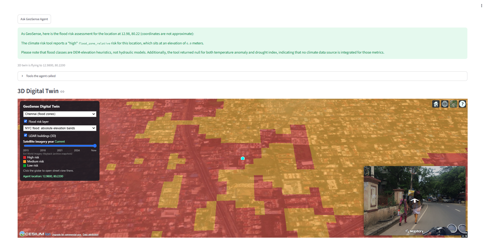

# GeoSense Agent 2.0

A geospatial AI project that turns raw map, elevation, LiDAR and street-level data into answers to plain-English questions
such as *"Is the area at 13.0827, 80.2707 in Chennai prone to flooding?"*

Built by Packiarajan Siva (M.Tech Geoinformatics, University of Madras) as a portfolio project.

## Phases

| Phase | Folder | What it does |
|-------|--------|--------------|
| 1 | `src/phase1_ml` | Machine-learning site scoring for Chennai (features from roads, hospitals, flood risk; SHAP explanations) |
| 2 | (separate GeoVision_Agent project) | Land-use semantic segmentation on Sentinel-2 imagery - not yet connected to this repository |
| 3 | `src/phase3_lidar` | LiDAR processing and street-view scene analysis (Mapillary + SegFormer) |
| **4** | `src/phase4_agent`, `frontend/digital_twin` | **MCP server, GeoAI agent, 3D Digital Twin and Streamlit demo** (below) |

## Phase 4 - MCP Server, GeoAI Agent and 3D Digital Twin

Phase 4 wraps the analysis modules as seven tools behind one server, lets a Claude-powered LangGraph agent choose and call them,
and shows the results on a CesiumJS 3D globe.

```
Streamlit (8501) --question--> LangGraph agent --HTTP--> MCP server (8000) --> 7 tools --> PostGIS / LiDAR / rasters
      |                                                        |
      | embeds                                                 +-- /agent/latest_result <-- polled every 3 s
      v                                                                                           |
CesiumJS twin (5173) <------------- flies the camera and opens street view ----------------------+
```

### What it can do

- **Ask in plain English.** The agent picks the right tools, reads their output and writes an evidence-based answer. It keeps context across follow-up questions in the same conversation.
- **Seven geospatial tools** over REST and the Model Context Protocol: site scoring, flood-zone risk, LiDAR building profile, street-view scene and walkability, nearest hospital, similar sites, and an imagery classifier (placeholder until GeoVision is connected).
- **Honest about its limits.** Outside the covered areas (Chennai; Manhattan, New York) the tools return an explicit "no data" message and the agent says so instead of inventing numbers. Flood layers are elevation-based estimates, not hydraulic models.
- **3D Digital Twin.** Real-world terrain, colour-coded flood-risk zones, about 2,000 LiDAR-derived 3D buildings in Manhattan, a site switcher, and clickable live Mapillary street view. The camera flies to whatever location the agent returns.
- **One-click demo.** `start_all.bat` starts the server, twin and Streamlit page; `stop_all.bat` stops them.

<!-- Screenshot of the 3D twin: add docs/images/digital_twin.png and uncomment the next line

-->

### Quick start (Windows)

1. Create the conda environment (`environment_geosense2.yml`) and a PostGIS database with the project layers.
2. Copy your keys into `.env` (see `src/phase4_agent/README.md`): `ANTHROPIC_API_KEY`, `MAPILLARY_TOKEN`, database settings.
3. In `frontend/digital_twin/.env` set `VITE_CESIUM_ION_TOKEN` and `VITE_MAPILLARY_TOKEN`, then `npm install` once.
4. Double-click `start_all.bat` and open http://localhost:8501.

Full setup, endpoints, usage examples and troubleshooting: [`src/phase4_agent/README.md`](src/phase4_agent/README.md).

### Tests

```
python -m pytest tests/test_phase4_agent.py -v                # 18 tests (server running on :8000)
python -m pytest tests/test_phase4_agent.py -v -m "not agent" # skip the 4 tests that call the Anthropic API
```

### Status

- Working: the MCP server and tools, the agent with the Claude API, the Streamlit demo, the 3D twin with flood, LiDAR, street-view and agent-driven camera.
- Not done yet: the historical imagery year slider, connecting `classify_imagery` to the GeoVision model, NDVI and climate-risk overlays.

### Tech

Python, FastAPI, Model Context Protocol (`mcp`), LangGraph, LangChain Anthropic (Claude), Streamlit, PostGIS, GeoPandas, LiDAR (LAZ) processing,
SegFormer (Hugging Face), CesiumJS, Vite, Mapillary.

### Data

NOAA 2017 NYC topobathy DEM, NYC LiDAR (Manhattan tiles), Chennai DEM, an OpenStreetMap extract, Mapillary street-level imagery, Cesium Ion world terrain.
