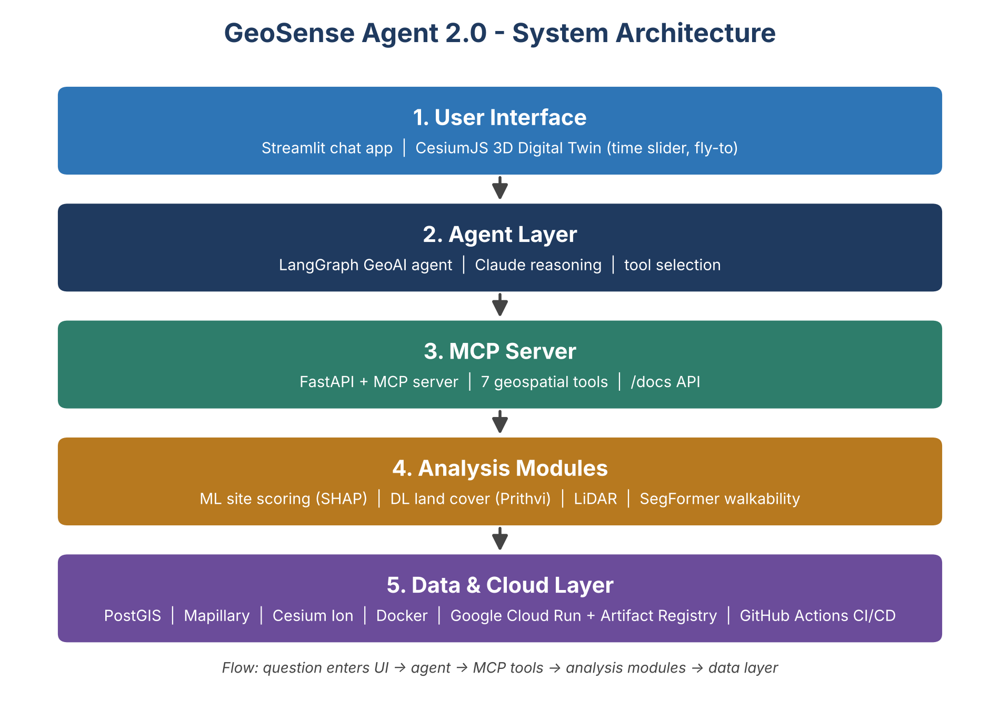

# GeoSense Agent 2.0

> Conversational geospatial intelligence: ask a plain-English question about a place and an AI agent calls machine-learning, deep-learning, LiDAR and street-view tools to answer, with a 3D digital twin that flies to the result.

[Live demo](https://YOUR-FRONTEND-URL) | [Demo video](https://YOUR-VIDEO-URL) | [API docs](https://YOUR-BACKEND-URL/docs)

<!-- Badges: add build status, license, python-3.11 -->

## The problem
(One paragraph, adapted from Section 1.2 of the blueprint.)

## Architecture

## Tech stack
| Layer | Technology |
|---|---|
| Interface | Streamlit, CesiumJS 3D digital twin (Vite) |
| Agent | LangGraph, Claude (langchain-anthropic) |
| Tool server | FastAPI + Model Context Protocol (REST `/tools/*` and MCP at `/mcp`) |
| Analysis | XGBoost + SHAP site scoring, U-Net land cover (Sentinel-2), LiDAR (laspy), SegFormer street-view walkability |
| Data | PostGIS, OpenStreetMap, Mapillary, Cesium Ion |
| Delivery | Docker, Google Cloud Run, GitHub Actions |

## The 7 tools
`score_location`, `classify_imagery`, `lidar_profile`, `streetview_scene`, `get_climate_risk`, `get_demographics`, `find_similar_sites`.
Coverage: Chennai and Manhattan, NYC. Outside coverage the tools return an explicit error and the agent says so rather than guessing.

## Screenshots
(4-6 images from `screenshots/`)

## Run locally
    docker compose -f deploy/docker-compose.yml --env-file .env up --build

## API documentation
Visit `/docs` on the backend URL.
